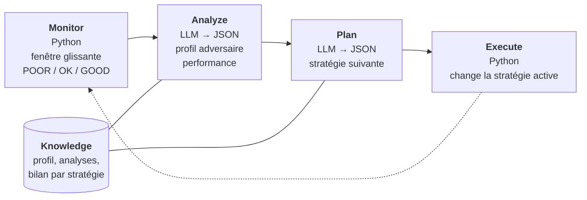
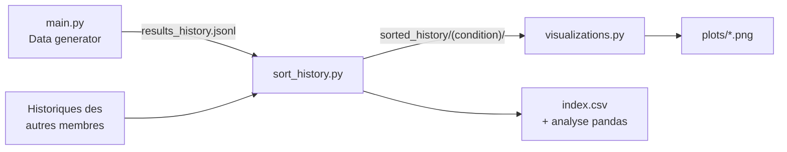

# Tournoi d'Axelrod : stratégies déterministes contre un LLM auto-adaptatif

**Stack :** Python 3.12 · [Axelrod](https://github.com/Axelrod-Python/Axelrod) 4.14 · [Google ADK](https://github.com/google/adk-python) 2.12 · Gemini

> Un joueur piloté par un LLM, doté d'une boucle auto-adaptative **MAPE-K**, affronte les stratégies classiques du **dilemme du prisonnier itéré**. Peut-il remonter au score quand il détecte qu'il joue mal ?

Projet du cours **HAI930I – Systèmes multi-agents** (Master IMAGINE, Université de Montpellier), « Project 1 » de [`subject.pdf`](subject.pdf).

---

## Sommaire

- [Présentation](#présentation)
- [Démarrage rapide](#démarrage-rapide)
- [Le joueur LLM et la boucle MAPE-K](#le-joueur-llm-et-la-boucle-mape-k)
- [Utilisation](#utilisation)
- [Configuration](#configuration)
- [Workflow d'expérimentation](#workflow-dexpérimentation)
- [Métriques et méthode d'analyse](#métriques-et-méthode-danalyse)
- [Trier l'historique : `sort_history.py`](#trier-lhistorique--sort_historypy)
- [Visualiser : `visualizations.py`](#visualiser--visualizationspy)
- [Architecture du code](#architecture-du-code)
- [Fichiers de données](#fichiers-de-données)

---

## Présentation

Le programme rejoue le **tournoi d'Axelrod** sur le dilemme du prisonnier itéré :

- d'un côté, **9 stratégies classiques et déterministes** (Tit For Tat, Grudger, Defector…), fournies par la bibliothèque [Axelrod](https://github.com/Axelrod-Python/Axelrod) ;
- de l'autre, **un joueur piloté par un LLM** (Gemini, via [Google ADK](https://github.com/google/adk-python)). Pendant le match, il surveille ses performances et le comportement de l'adversaire, et **change de stratégie de prompt** quand il le juge utile.

### Fonctionnalités

- **Matchs 1v1** commentés round par round, et **tournois round robin**.
- **Boucle MAPE-K** (Monitor, Analyze, Plan, Execute, Knowledge) configurable, désactivable pour servir de référence.
- **Strategy lab** : consultation, édition et ajout de stratégies de prompt, avec persistance.
- **Data generator** : balayage de paramètres (produit cartésien) pour produire des données d'expérience.
- **Historique persistant** (JSON Lines, en ajout seul), replay et export CSV.
- **Chaîne d'analyse** : tri des résultats par condition de test (`sort_history.py`) et génération de graphiques (`visualizations.py`, aussi accessible depuis le menu Results history avec `v`).
- **Tolérance aux pannes de l'API** : relances, bascule automatique entre modèles gratuits, coups de secours.

### Rappel : le jeu

À chaque round, les deux joueurs choisissent simultanément **C** (coopérer) ou **D** (trahir). Les gains sont ceux d'Axelrod par défaut :

| Moi \ Adversaire | C | D |
|---|---|---|
| **C** | 3 / 3 (R, récompense) | 0 / 5 (S, pigeon) |
| **D** | 5 / 0 (T, tentation) | 1 / 1 (P, punition) |

Un joueur marque entre **0 et 5 points par round**. La coopération mutuelle rapporte 3 points par round ; face à un traître inconditionnel, on ne peut pas faire mieux que 1.

---

## Démarrage rapide

### Prérequis

- Python **3.10+** (le projet est développé avec 3.12) ;
- une clé API Gemini : [aistudio.google.com/apikey](https://aistudio.google.com/apikey).

### Installation

```sh
python -m venv .venv
.venv/bin/pip install axelrod==4.14.0 google-adk==2.12.0 python-dotenv==1.2.4
.venv/bin/python main.py
```

### Clé API

Au choix :

| Méthode | Commande |
|---|---|
| Variable d'environnement | `export GOOGLE_API_KEY="ma-clé"` |
| Fichier `.env` à côté de `main.py` | `GOOGLE_API_KEY=ma-clé` |
| Rien | Au premier match, le programme la demande (saisie masquée) et l'écrit dans `.env`. |

### Coût en appels API

Un match impliquant le LLM coûte environ **1 appel par round + 2 appels par cycle MAPE-K** :

```
appels = turns + 2 × ((turns − 1) // mapek_every)
```

Avec les réglages par défaut (10 rounds, MAPE-K tous les 5 rounds), cela fait **12 appels par match**. Les matchs entre stratégies classiques sont gratuits. Le palier gratuit de Gemini est limité à environ 15 requêtes par minute.

---

## Le joueur LLM et la boucle MAPE-K

À **chaque round**, un agent ADK reçoit le prompt de la **stratégie active**, le score, le taux de coopération de l'adversaire et les `history_shown` derniers coups, puis répond `C` ou `D`. Le LLM **ne connaît jamais le nom de l'adversaire** : il doit le déduire de ses coups.

Tous les `mapek_every` rounds (si `adaptive` est activé), la boucle MAPE-K se déclenche :



| Étape | Exécutée par | Rôle |
|---|---|---|
| **Monitor** | Python | Sur les `window` derniers rounds : score moyen du LLM et de l'adversaire, comparaison avec la fenêtre précédente, taux de coopération de l'adversaire. Alerte **POOR** si la moyenne < `poor_threshold`, **GOOD** si ≥ 2,5, **OK** sinon. |
| **Analyze** | LLM | Profile l'adversaire (traître, coopérateur, type tit-for-tat, rancunier, alternateur…) et juge la performance *par rapport à ce qui est atteignable* contre lui. Répond `opponent_profile`, `performance`, `insight`. |
| **Plan** | LLM | Choisit la stratégie des prochains rounds à partir de l'analyse, du catalogue de stratégies, du bilan de chacune et des rounds restants. Répond `strategy`, `reason`. |
| **Execute** | Python | Remplace la stratégie active. Un nom inconnu conserve la stratégie actuelle. |
| **Knowledge** | Python | Profil de l'adversaire, analyses passées et **bilan par stratégie** du match (rounds joués, points moyens, coopération adverse). |

**Robustesse.** Les réponses JSON sont lues même entourées d'autre texte ; un coup illisible ou un appel en échec est remplacé par **tit-for-tat** pour ce round. Côté API, chaque appel est relancé jusqu'à 3 fois en respectant le délai demandé, puis le programme **bascule sur un autre modèle gratuit** (quota du jour épuisé, modèle payant ou inconnu, surcharge persistante). Quand plus rien n'est possible, la partie s'arrête proprement.

---

## Utilisation

```
  1) 1v1 match        LLM vs one classic strategy (round by round)
  2) Tournament       LLM + classic strategies, round robin
  3) Strategy lab     view / edit / add the LLM prompt strategies
  4) Settings         rounds, MAPE-K period, model, adaptive on/off ...
  5) Results history  browse every saved 1v1 / tournament, export to CSV
  6) Data generator   sweep settings, run every combination as a 1v1 match
  7) Quit
```

`Ctrl-C` interrompt la partie en cours et ramène au menu ; au menu principal, `Ctrl-C`, `7` ou `q` quitte.

### 1) 1v1 match

1. Choisir la **stratégie de base** du LLM (Entrée = la stratégie actuelle). Le choix est mémorisé dans `initial_strategy`.
2. Choisir l'**adversaire** parmi les 9 stratégies déterministes :

   | Adversaire | Comportement |
   |---|---|
   | Cooperator | Coopère toujours. |
   | Defector | Trahit toujours. |
   | Tit For Tat | Coopère au premier round, puis copie le dernier coup adverse. |
   | Tit For 2 Tats | Ne trahit qu'après deux trahisons consécutives. |
   | Suspicious Tit For Tat | Comme Tit For Tat, mais commence par trahir. |
   | Grudger | Coopère jusqu'à la première trahison, puis trahit pour toujours. |
   | Alternator | Alterne C, D, C, D… |
   | Prober | Ouvre par D, C, C ; exploite l'adversaire s'il n'a pas riposté, joue tit-for-tat sinon. |
   | Win-Stay Lose-Shift | Garde son coup s'il a bien marqué, en change sinon (Pavlov). |

3. Le match s'affiche **round par round** (coups, points, stratégie active), avec la trace de chaque cycle MAPE-K (lignes `M`, `A`, `P/E`).
4. En fin de match : résultat, moyennes par round, comparaison début/fin, **tendance** et **timeline** des stratégies. Le match est ajouté à l'historique.

### 2) Tournament

Choisir la stratégie de base du LLM, puis les adversaires (numéros séparés par des virgules, Entrée = tous). Axelrod joue un **round robin**, `repetitions` fois par paire ; le LLM ne s'affronte lui-même que si `llm_self_play` est activé. En fin de tournoi : **classement** (score normalisé = points moyens par round) et tableau des matchs du LLM (moyennes, sparkline par blocs de `window` rounds, tendance, changements de stratégie). Un tournoi interrompu sauvegarde les matchs déjà terminés avec le statut `aborted`.

### 3) Strategy lab

| Touche | Action |
|---|---|
| `v` | Voir le prompt complet d'une stratégie. |
| `e` | Éditer le prompt (multiligne, terminé par une ligne vide) et le résumé d'une stratégie. |
| `a` | Ajouter une stratégie : nom unique, prompt, résumé. **Le résumé est la seule chose que l'agent Plan voit** de la stratégie. |
| `d` | Supprimer une stratégie (refusé s'il n'en reste que 3, minimum imposé par le sujet). |
| `r` | Réinitialiser les 4 stratégies par défaut (supprime `llm_strategies.json`). |
| `b` / Entrée | Retour. |

Les modifications sont enregistrées immédiatement dans `llm_strategies.json`. Stratégies fournies :

| Stratégie | Comportement |
|---|---|
| **Generous** | Coopère par défaut ; ne trahit qu'après 3 trahisons consécutives de l'adversaire. |
| **Pragmatic** | Réciproque (façon tit-for-tat), mais pardonne une trahison isolée après 5 coopérations. |
| **Merciless** | Trahit à chaque round. |
| **Peacemaker** | Rompt les spirales de trahison mutuelle en proposant de coopérer ; avertit par un D ponctuel quand elle se fait exploiter. |

### 4) Settings

Voir [Configuration](#configuration).

### 5) Results history

Affiche les 20 dernières sessions (date, type, moyenne du LLM, modèle, résumé).

| Saisie | Action |
|---|---|
| un numéro | Ouvre la session (réglages, classement, matchs), puis le **replay round par round** d'un match avec la raison de chaque changement de stratégie. |
| `a` | Liste tous les matchs sauvegardés. |
| `e` | Exporte tout l'historique vers `results_matches.csv` (une ligne par match du LLM). |
| `v` | Lance la **visualisation** : génère les graphiques (voir [Visualiser](#visualiser--visualizationspy)). |
| `f` | Bascule entre listes récentes et listes complètes. |
| `b` / Entrée | Retour. |

### 6) Data generator

L'outil de production de données : il joue **toutes les combinaisons** de paramètres choisies, chacune comme un match 1v1 en affichage compact.

1. **Adversaires** et **stratégies de base** : un ou plusieurs (Entrée = tous).
2. **Paramètres balayés** : `model`, `temperature`, `turns`, `mapek_every`, `window`, `poor_threshold`. Chacun accepte une valeur (`10`), une liste (`10, 20, 40`) ou une plage `début:fin[:pas]` fin incluse (`0:1:0.25`), combinables. Entrée = valeur des Settings.
3. **`adaptive`** : `y`, `n` ou `both`. `both` joue chaque combinaison avec et sans MAPE-K, idéal pour mesurer l'apport de la boucle.
4. **`repetitions`** = nombre de matchs par combinaison (non balayé). `history_shown` et `seed` reprennent les Settings.
5. Le générateur affiche un **plan** (nombre de matchs, d'appels LLM, durée estimée) et demande confirmation.

Chaque match devient sa propre session 1v1 ; toutes les sessions d'un lancement partagent un identifiant `batch` (`gen-AAAAMMJJ-HHMMSS`). Le lancement s'arrête au premier match impossible à terminer, en gardant les matchs déjà joués, et restaure les Settings. Un plan interrompu peut être **relancé sans risque** : `sort_history.py` regroupe les deux lancements et retire les matchs rejoués à l'identique.

> **Exemple.** 3 adversaires × 4 stratégies × `adaptive=both` × 3 répétitions = 72 matchs, soit environ 864 appels (10 rounds, MAPE-K tous les 5 rounds).

---

## Configuration

Les réglages se modifient dans le menu **Settings** et ne durent que le temps de l'exécution. Les valeurs par défaut sont définies dans [`config.py`](config.py), qui fait référence. Pour les booléens, `y`, `yes`, `true`, `1` et `on` valent *vrai*.

| Réglage | Défaut | Description |
|---|---|---|
| `model` | `gemini-3.1-flash-lite` | Modèle Gemini utilisé par tous les agents. |
| `auto_switch_model` | `True` | Bascule sur le modèle suivant de `FREE_MODELS` en cas de quota épuisé, de modèle payant ou inconnu, ou de surcharge persistante. Désactivé, la partie s'arrête à la place. |
| `temperature` | `0.2` | Température d'échantillonnage (0 à 2). |
| `turns` | `10` | Rounds par match. |
| `repetitions` | `1` | Matchs par paire dans un tournoi. |
| `seed` | `1` | Graine aléatoire d'Axelrod. |
| `mapek_every` | `5` | Période de la boucle MAPE-K (en rounds). |
| `window` | `5` | Taille de la fenêtre de Monitor et de la tendance. |
| `poor_threshold` | `1.5` | Moyenne par round sous laquelle Monitor lève l'alerte POOR. |
| `history_shown` | `10` | Rounds d'historique montrés à l'agent qui joue. |
| `initial_strategy` | `Generous` | Stratégie de départ, volontairement naïve pour rendre un comeback visible. |
| `adaptive` | `True` | Active MAPE-K. Désactivé, le LLM reste figé sur sa stratégie de départ (**baseline**). |
| `llm_self_play` | `False` | En tournoi, le LLM affronte aussi une copie de lui-même. |

---

## Workflow d'expérimentation



```sh
.venv/bin/python main.py                               # 6) Data generator
python sort_history.py                                 # range results_history.jsonl par condition
python sort_history.py results_history_prenom.jsonl    # ajoute l'historique d'un autre membre
python visualizations.py sorted_history                # 6 graphiques par condition
```

1. **Jouer** : chaque match est ajouté à `results_history.jsonl`.
2. **Trier** : `sort_history.py` sépare les tests par condition, fusionne les lancements interrompus et retire les doublons de relance. Il lit directement les `.jsonl` (pas besoin d'export CSV) et **cumule** les fichiers de tous les membres du groupe.
3. **Visualiser** : `visualizations.py` produit les graphiques de chaque condition.
4. **Analyser** : avec les métriques ci-dessous, en s'appuyant sur `sorted_history/index.csv`.

---

## Métriques et méthode d'analyse

Toutes les métriques sont calculées par le programme. On les trouve match par match dans `results_matches.csv` et dans le `matches.csv` de chaque condition, et en détail dans les `.jsonl`. Les comparaisons n'ont de sens qu'**à condition égale** (même température, même nombre de rounds, même réglage MAPE-K…) : c'est le rôle de `sort_history.py`.

### Métriques par match

| Métrique | Colonne(s) CSV | Définition et interprétation |
|---|---|---|
| **Score moyen par round** | `llm_avg`, `opp_avg` | Points ÷ rounds, entre 0 et 5. **Critère principal**, celui que récompense le tournoi d'Axelrod. Repères : 3 = coopération mutuelle, 1 = trahison mutuelle, 5 = exploitation totale. |
| **Score total** | `llm_score`, `opp_score` | Somme des points du match. |
| **Issue** | `outcome` | `win`, `loss` ou `draw`. **À interpréter avec prudence** : Tit For Tat ne gagne jamais un match mais remporte les tournois ; un `draw` 30–30 vaut mieux qu'un `win` 14–9. |
| **Tendance** | `trend` | Moyenne des `window` derniers rounds moins celle des `window` premiers (≥ `2 × window` rounds requis). ≥ +0,5 : **comeback** si le début était sous `poor_threshold`, **improved** sinon ; ≤ −0,5 : **declined** ; sinon **steady**. **Répond directement à la question du sujet.** |
| **Changements de stratégie** | `n_switches`, `switches` | Activité de la boucle MAPE-K. Aucun changement contre Defector en partant de Generous signale un problème ; beaucoup contre un adversaire stable, de l'instabilité. |
| **Stratégie finale** | `final_strategy`, `initial_strategy` | Vers quelle stratégie la boucle converge contre chaque adversaire. |
| **Rang en tournoi** | `llm_rank`, `n_players` | Place du LLM au classement (score normalisé). Robustesse face à une population. Vide en 1v1. |
| **Modèle(s)** | `model` | Modèles ayant réellement répondu (`a + b` après une bascule). |

Dans les `.jsonl`, chaque match contient aussi ses `episodes` (`{strategy, first, last, avg}` : score moyen pendant chaque période d'une stratégie) et ses `rounds` (chacun étiqueté par la stratégie active). C'est ce bilan que l'étape Plan reçoit en direct, par exemple « Generous r1-5 (0,0) → Merciless r6-10 (1,0) » contre Defector.

### Méthode

1. **Générer** avec le Data generator : tous les adversaires × toutes les stratégies de base, `adaptive = both`, au moins 3 répétitions (le LLM n'est pas déterministe). Puis trier avec `sort_history.py`.
2. **Meilleure stratégie figée** par adversaire : filtrer `adaptive == False`, grouper par `(opponent, initial_strategy)`, comparer la moyenne de `llm_avg`.
3. **Apport de MAPE-K** : `llm_avg(adaptive=True) − llm_avg(adaptive=False)` pour chaque `(opponent, initial_strategy)`.
4. **Capacité de comeback** : proportion de `trend == "comeback"` parmi les matchs adaptatifs mal commencés. Attendue élevée contre Defector, Grudger ou Suspicious Tit For Tat en partant de Generous.
5. **Réglages MAPE-K** : comparer `llm_avg` et taux de comeback selon `mapek_every`, `window`, `poor_threshold`, `temperature`. Une boucle trop fréquente réagit au bruit, une boucle trop rare réagit trop tard.
6. **Robustesse globale** : comparer `llm_rank` en tournoi entre configurations.

<details>
<summary><b>Exemple d'analyse avec pandas</b></summary>

```python
import pandas as pd
from pathlib import Path

df = pd.concat(
    pd.read_csv(f).assign(condition=f.parent.name)
    for f in Path("sorted_history").glob("*/matches.csv")
)
index = pd.read_csv("sorted_history/index.csv")  # une ligne par condition, avec repetitions
df = df.merge(index[["folder", "repetitions"]], left_on="condition", right_on="folder")

# on fixe tout sauf ce qu'on compare : ici 1 répétition, 1v1, MAPE-K tous les 5 rounds
df = df[(df.kind == "1v1") & (df.repetitions == 1) & ((df.mapek_every == 5) | (df.adaptive == False))]

# effet de la température (et de MAPE-K) sur le score moyen, adversaire par adversaire
print(df.pivot_table(index="opponent", columns=["temperature", "adaptive"], values="llm_avg").round(2))

df = df[df.temperature == 0.1]  # pour les étapes 2 à 4, on fixe aussi la température

# 2. meilleure stratégie figée contre chaque adversaire
fixed = df[df.adaptive == False]
print(fixed.groupby(["opponent", "initial_strategy"]).llm_avg.mean().unstack().round(2))

# 3. gain apporté par MAPE-K
gain = df.pivot_table(index=["opponent", "initial_strategy"], columns="adaptive", values="llm_avg")
print((gain[True] - gain[False]).round(2))

# 4. taux de comeback (matchs adaptatifs)
ad = df[df.adaptive == True]
print(ad.groupby("opponent").trend.apply(lambda t: (t == "comeback").mean()).round(2))
```

Pour une seule condition : `pd.read_csv("sorted_history/<condition>/matches.csv")`. Pour un seul lancement du générateur : `df[df.batch == "gen-20261031-133521"]`.

</details>

---

## Trier l'historique : `sort_history.py`

Un historique mélange tous les tests (températures, répétitions, adaptive ou non, `mapek_every`…), des modèles différents selon les quotas et des lancements relancés après interruption ; chaque membre du groupe a en outre son propre fichier. `sort_history.py` réunit ces fichiers dans `sorted_history/`, **un dossier par condition de test**. Il n'utilise que la bibliothèque standard (aucune clé API, n'importe quel Python 3.10+).

### Utilisation

```sh
python sort_history.py                                   # ajoute results_history.jsonl
python sort_history.py results_history_a.jsonl results_history_b.jsonl
python sort_history.py --dry-run results_history_a.jsonl # montre ce qui changerait, n'écrit rien
```

| Option | Effet |
|---|---|
| `FICHIER…` | Historiques à ajouter (défaut : `results_history.jsonl`, cherché dans le dossier courant puis à côté du script). |
| `-o DOSSIER` | Dossier de sortie (défaut : `sorted_history/`). Refuse un dossier non vide qu'il n'a pas créé (marqueur `.sort_history`). |
| `--ignore CHAMP…` | Ne pas séparer selon ces réglages (ex. `--ignore adaptive` réunit adaptatif et figé). Un dossier de sortie garde toujours le même `--ignore`. |
| `--keep-duplicates` | Conserver les matchs rejoués à l'identique. |
| `--dry-run` | Afficher ce qui serait ajouté, sans écrire. |

Les lignes qui ne sont pas des sessions (commentaires ajoutés à la main) sont ignorées et signalées.

### Fonctionnement cumulatif

`sorted_history/` n'est **jamais écrasé** : chaque appel ajoute les nouvelles sessions à celles déjà présentes.

- Chaque session est marquée de son fichier d'origine (`source`), visible dans les `history.jsonl`, les `matches.csv` et `index.csv`.
- Une session déjà présente (même contenu complet) n'est pas ajoutée deux fois : on peut relancer le script sur un fichier qui s'est rempli entre-temps.
- Les dossiers `plots/` ne sont pas touchés ; relancer `visualizations.py` pour les mettre à jour.
- Pour repartir de zéro (par exemple pour changer de `--ignore`), supprimer `sorted_history/` puis relancer le script sur chaque fichier.

### Définition d'une condition

Deux matchs appartiennent à la même condition s'ils partagent : `kind` (1v1 ou tournoi), `temperature`, `repetitions`, `adaptive`, `mapek_every`, `turns`, `window`, `poor_threshold`, `history_shown`, `seed`, `llm_self_play` et **les mêmes prompts de stratégies**. L'adversaire et la stratégie de base n'en font pas partie : ce sont les dimensions comparées dans les graphiques d'un dossier.

- **Le modèle n'est pas une condition.** Il ne change que pour contourner les quotas du palier gratuit ; on suppose donc tous les modèles équivalents. Les modèles utilisés restent consultables dans `index.csv` et la colonne `model`.
- **Baseline figée** : sans MAPE-K, `mapek_every` est ignoré.
- **Relances et membres du groupe** : un lancement relancé ou les tests d'un autre membre dans les mêmes conditions tombent dans le même dossier.

Le nom du dossier est stable : type, température, répétitions, adaptive/fixed et, en adaptatif, `mapek_every`, suivis des seuls réglages qui diffèrent des valeurs habituelles (ex. `turns20`, `w10`, `prompts-1a2b3c`) :

```
1v1_T0.1_rep1_adaptive_mapek5
1v1_T0.2_rep5_fixed
1v1_T0.2_rep1_adaptive_mapek5_turns20_w10
```

### Doublons de relance

Un plan relancé rejoue des matchs déjà joués. Un match est retiré seulement s'il est **strictement identique** (réglages, prompts, coups, scores, changements de stratégie et raisons ; seuls la date, l'id, le `batch` et le modèle peuvent différer) à un match d'un **autre lancement**, de la **même condition** et du **même fichier**.

- Les répétitions identiques **au sein d'un même lancement** sont de vraies mesures et sont gardées : pour chaque contenu, on garde autant d'exemplaires que le lancement qui en contient le plus.
- Deux membres du groupe obtenant le même résultat ont fait deux mesures indépendantes : les deux sont gardées.
- Les sessions retirées sont conservées dans `duplicates_removed.jsonl`.

> [!NOTE]
> Un match au résultat forcé (ex. Generous contre Cooperator, toujours CC) n'est compté, par condition, qu'autant de fois que dans le lancement qui en contient le plus, alors qu'un match au résultat variable est gardé à chaque lancement. Les moyennes par adversaire et par stratégie n'en sont presque pas affectées, mais les agrégats sur tout un dossier (camembert des issues, moyenne globale) donnent moins de poids aux résultats forcés. `--keep-duplicates` donne l'autre point de vue.

### Sortie

```
sorted_history/
├── .sort_history                  marqueur (et --ignore utilisé)
├── index.csv                      une ligne par condition : réglages, nombre de matchs, doublons retirés,
│                                  fichiers d'origine, modèles, lancements, dates
└── 1v1_T0.1_rep1_adaptive_mapek5/
    ├── history.jsonl              sessions gardées (format de results_history.jsonl + source)
    ├── matches.csv                format de results_matches.csv + source → visualizations.py
    ├── duplicates_removed.jsonl   doublons retirés (s'il y en a)
    └── plots/                     créé par visualizations.py
```

---

## Visualiser : `visualizations.py`

Script qui lit un CSV de matchs et produit **6 graphiques PNG** (300 dpi). Il s'utilise de deux façons :

- **depuis le programme** : menu `5` (Results history), puis touche `v` ;
- **en ligne de commande**, de façon autonome (voir [Lancement](#lancement)), ce qui permet de choisir les CSV ou dossiers à traiter, par exemple ceux de `sorted_history/`.

### Prérequis

Il nécessite `pandas`, `numpy`, `matplotlib` et `seaborn`, absents de l'installation de base :

```sh
.venv/bin/pip install pandas matplotlib seaborn
```

Le CSV doit être à jour : relancer `sort_history.py` pour les graphiques par condition, ou refaire l'export (menu `5` → `e`) pour l'historique complet.

### Lancement

```sh
python visualizations.py                                         # results_matches.csv → PNG dans le dossier courant
python visualizations.py sorted_history                          # toutes les conditions
python visualizations.py sorted_history/1v1_T0.1_rep1_adaptive_mapek5
python visualizations.py a/matches.csv b/matches.csv
```

Avec des arguments, les graphiques de chaque CSV sont écrits dans un dossier `plots/` à côté de lui, avec le nom de la condition en sous-titre. Pour un dossier, le script prend son `matches.csv`, sinon tous les `*/matches.csv` qu'il contient. Les fichiers existants sont écrasés.

| Fichier | Graphique | Lecture |
|---|---|---|
| `plot_1_avg_payoff.png` | Barres : `llm_avg` moyen par adversaire | Contre qui le LLM marque le plus ou le moins. |
| `plot_2_outcomes.png` | Camembert win / loss / draw | Répartition des issues (gagner n'est pas l'objectif). |
| `plot_3_parity.png` | Nuage : score LLM contre score adverse, diagonale y = x | Au-dessus : victoires. En haut à droite : coopération mutuelle ; en bas à gauche : trahison mutuelle. |
| `plot_4_switches.png` | Boîtes : `n_switches` par adversaire | Activité de la boucle MAPE-K. |
| `plot_5_evolution.png` | Heatmap : stratégie initiale → finale | Convergence de la boucle ; la diagonale = aucun changement. |
| `plot_6_rank.png` | Boîtes : `llm_rank` en tournoi par modèle et température | Comparaison en tournoi (message explicite s'il n'y a pas de données). |

### Limites

- Sans argument, le script mélange **tout** l'historique (1v1 et tournois, toutes conditions) : préférer les graphiques par condition.
- Les graphiques d'une condition ne comparent pas les conditions entre elles : mettre les `plots/` côte à côte ou passer par pandas.
- Le graphique 1 ne montre que des moyennes ; la dispersion (boxplot de `llm_avg`) est nécessaire pour juger de la fiabilité d'un écart.
- Le graphique 6 ne concerne que les tournois ; dans une condition, une seule température est présente.

---

## Architecture du code

```
.
├── main.py              point d'entrée : boucle du menu principal
├── menus.py             menus 1v1, Tournoi, Strategy lab, Settings ; validation des saisies
├── config.py            dataclass Config (défauts) et liste FREE_MODELS ; charge .env
├── runtime.py           singleton RT : config, stratégies, Brain, MatchRecord en cours
├── player.py            LLMPlayer : boucle MAPE-K et choix du coup
├── brain.py             client LLM synchrone (Google ADK) : cache, relances, bascule de modèle
├── prompts.py           instructions des agents Move, Analyze et Plan
├── strategies.py        stratégies de prompt par défaut, MIN_STRATEGIES = 3
├── opponents.py         adversaires déterministes (ajouter un adversaire ici)
├── matches.py           exécution des 1v1 et tournois, estimation des appels, classement
├── records.py           Round, MatchRecord (totaux, épisodes, tendance), Knowledge
├── history.py           historique JSON Lines et export CSV
├── history_view.py      menu Results history : listes, replay, export, visualisation (`v`)
├── generator.py         menu Data generator : balayage de paramètres
├── display.py           affichage en direct des rounds et de la trace MAPE-K
├── terminal.py          couleurs, saisie, sparklines
├── sort_history.py      script autonome : tri de l'historique par condition
└── visualizations.py    script autonome : graphiques
```

Points de conception notables :

- **`runtime.RT`** : Axelrod clone et réinitialise les joueurs avant chaque match. Un joueur ne pouvant pas conserver d'état propre, la configuration et le client LLM vivent dans un singleton partagé.
- **`brain.Brain`** : une boucle asyncio unique pour tout le programme, un runner ADK mis en cache par agent, et une session jetable par appel. Les agents n'ont donc **aucune mémoire conversationnelle** : tout le contexte passe dans le prompt.
- **`player.LLMPlayer`** : le LLM ne voit jamais le nom de l'adversaire ; chaque round est enregistré avec la stratégie active, ce qui permet le bilan par stratégie.

---

## Fichiers de données

| Fichier | Versionné | Contenu |
|---|---|---|
| `.env` | non | Clé `GOOGLE_API_KEY`. |
| `llm_strategies.json` | non | Stratégies modifiées dans le Strategy lab. Ignoré (avec avertissement) s'il est invalide. |
| `results_history.jsonl` | **oui** | **Donnée source** : une session par ligne, avec config, prompts et chaque round de chaque match. Jamais réécrit. |
| `results_history_<prénom>.jsonl` | — | Historiques des autres membres du groupe, à passer à `sort_history.py`. |
| `results_matches.csv` | non | Export à plat (une ligne par match du LLM), entrée par défaut de `visualizations.py`. |
| `sorted_history/` | non | Sortie de `sort_history.py`. Reconstructible à partir des fichiers d'historique. |